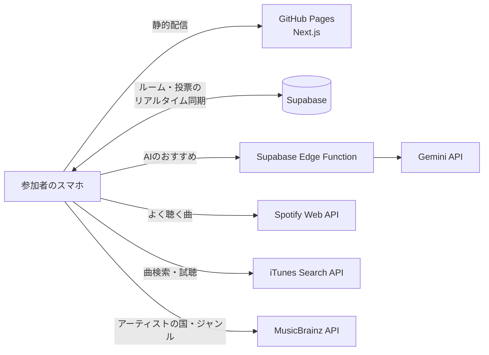

# [ミューコネ（MusiConnect）](https://jphacks.github.io/tkb_2619/)

共通の好みの曲が、心をつなぐ。世代も国籍も好みも違うみんなで、スワイプ投票しながら「いま流す1曲」を見つける選曲アプリです。

## 各種リンク

- **アプリURL**: https://jphacks.github.io/tkb_2619/
<!-- デモ動画・発表スライドのURLができたらここに追加する -->

### アプリ QR コード

> [!TIP]
> スマートフォンでのアクセスがおすすめです。1人で試すときは、ルーム画面の「デモ用に5人追加する」で、世代や国籍の違う5人が参加した状態を再現できます。

## 製品概要

### 背景(製品開発のきっかけ、課題等）

上司とのカラオケで、何を歌えばいいか分からない。留学先のパーティーで、みんなが盛り上がる曲が分からない。サークルの初ドライブで、無難な曲ばかり流してしまう。こんな経験、ありませんか？

| シーン | ギャップ | 起きていること |
| --- | --- | --- |
| 上司とのカラオケ | 世代 | 上司の好きな曲が分からず、歌う曲を選びにくい |
| 留学先でのホームパーティー | 国籍 | 文化や言語の違いから、盛り上がる曲を選べない |
| サークルでの初ドライブ | 音楽ジャンル | 同乗者の好みが分からず、無難な曲ばかり流してしまう |

好きな曲が同じだと分かれば、初対面でも一気に打ち解けられます。ところが音楽アプリのおすすめは「自分ひとりの好み」向けで、「その場の全員が楽しめる1曲」を決める仕組みはありませんでした。

### 製品説明（具体的な製品の説明）

「好きな曲は？」と聞いても、気をつかって本音は出にくいもの。そこでミューコネは、好みを聞き出すのではなく、再生履歴の「被り」とスワイプの「反応」から、みんなの共通点を見つけます。

1. **ルームを作る**: 幹事が、集まる人の年代・国籍・ジャンルを選んで招待URLとQRコードを発行
2. **参加する**: Spotify と連携するか、アカウントなしで参加
3. **候補が集まる**: みんなの再生履歴の「被り」、検索して追加した曲、集団に合わせたAIのおすすめ
4. **スワイプで投票**: 30秒試聴しながら、上下左右のスワイプで評価
5. **ランキングで決める**: 投票のたびに順位が入れ替わり、幹事が次に流す曲を決める

どの機能も、「共通の好みの曲で、心をつなぐ」ためにあります。

| 機能 | 役割 |
| --- | --- |
| 再生履歴の「被り」 | 知らなかった共通点に気づける |
| 集団に合わせたAIの提案 | 一部の人ではなく、全員に届く曲を候補にできる |
| スワイプ投票 | 声の大きい人に偏らず、全員の反応で決められる |
| 「◯◯が聴いてるよ！」の表示 | 共通点が、そのまま会話のきっかけになる |

### 想定ユーザーとニーズ

| 想定ユーザー | ニーズ | ミューコネでできること |
| --- | --- | --- |
| 飲み会・カラオケの幹事 | 全員が楽しめる曲を手早く決めたい | 属性を選んでURLを送るだけで候補が集まる |
| 上司と部下など、世代の違う人どうし | 相手の好きな曲を知りたい | 相手も聴いている曲が分かる |
| 留学生・国際交流の場の参加者 | 言葉が違っても一緒に盛り上がりたい | 国籍を複数選ぶと、どの国の人にも届く曲をAIが提案 |
| 初対面のグループ | 好みを聞きにくい | スワイプだけで、気をつかわずに好みを伝えられる |

### 既存サービスとの違い

| サービス | 内容 | ミューコネとの違い |
| --- | --- | --- |
| Jukestar | パーティーで曲をリクエスト・投票 | AIの提案や、世代・好みの差を埋める機能がない |
| Spotify のグループセッション | 同じ曲を一緒に聴き、プレイリストを共同操作 | 全員に Spotify アカウントが必要。選曲を助ける機能はない |
| MusicMate | 音楽の好みで1対1で出会うSNS | グループでの選曲ではない |
| PULL | 友達との音楽の相性診断 | その場でのリアルタイムな選曲ではない |

再生履歴の被り・集団に合わせたAIの提案・スワイプ投票を組み合わせたサービスは、調べた範囲では見つかりませんでした。アカウントなしでも参加できるので、Spotify を使っていない人も置いていきません。

### スケーラビリティと今後の展望

- **人数が増えても重くならない**: サーバーを持たない構成で、AIはルームごとに1回だけ呼んで全員で共有します。人数が増えてもAIのコストは増えません
- **場面と国を選ばない**: 二次会・懇親会・交流会など、音楽を流す場ならどこでも使えます。多言語化すれば海外でも使えます
- **法人化と有料プランで、Spotify・Apple Music を誰でも使えるように**: 現在の Spotify 連携は開発モードのため、事前に登録したメールアドレスでしか使えません。全員に開放する Spotify の審査は法人であることが条件のため、法人化して申請し、Apple Music にも対応します。幹事向けや、カラオケ店・イベント会場向けの有料プランで API の利用料をまかないます
- **投票から学ぶAI**: スワイプの結果をAIの提案に反映し、似た顔ぶれの集団で好まれた曲を推薦します
- **思い出を共有する**: 決まった曲に「なぜ好きか」をひと言添えられるようにし、会話をさらに広げます

### 解決出来ること

- 選曲の時間を短縮し、知らない曲ばかり流れる状況を防ぐ
- 世代・国籍・好みが違う相手とも、共通の好きな曲が見つかり、仲を深められる
- 声の大きい人に偏らず、全員の投票で1曲を決められる

ここまでの流れは、すべて[公開サイト](https://jphacks.github.io/tkb_2619/)で動きます。複数のスマホで同じルームに入ると、投票結果がリアルタイムで全員に反映され、AIの提案は10秒ほどで届きます。

<!-- ユーザーテストを行ったら、人数・場面・結果（例: 選曲にかかった時間、参加者の感想）をここに追記する -->

### 特長：スワイプで、選曲がゲームになる

マッチングアプリのように、カードを上下左右にスワイプするだけ。上=Best(3点) / 右=Better(2点) / 下=So-so(1点) / 左=Nope(0点) で直感的に評価でき、スワイプのたびに「Best!」とリアクションが弾みます。

カードには「◯◯が聴いてるよ！」と表示されます。「部長もこの曲聴くんですか！？」と、知らなかった共通点が見つかるたびに場が盛り上がり、入れ替わるランキングを全員でワクワクしながら見守れます。

### 注力したこと（こだわり等）

- **スワイプの手触り**: 指に吸い付くカードと大きなリアクションで、選曲そのものを楽しい時間にしました
- **「全員に届くか」で選ぶレコメンド**: 選んだ属性のうち何割に届くかで曲を評価し、一部の人だけが盛り上がる選曲を避けました
- **実在する曲だけを提案**: AIが挙げた曲を iTunes で照合し、実在が確認できた曲だけを候補に入れます。AIが使えないときは別の方法に自動で切り替わります

## 開発技術

### 活用した技術

- **フロントエンド**: Next.js（静的書き出し）/ TypeScript / Tailwind CSS / Framer Motion
- **バックエンド**: Supabase（PostgreSQL + Realtime、Edge Functions）
- **AI**: Gemini API（gemini-3.5-flash-lite）
- **外部API**: Spotify Web API / iTunes Search API / MusicBrainz API
- **インフラ**: GitHub Pages / GitHub Actions
- **デバイス**: スマートフォン

### 独自技術

#### ハッカソンで開発した独自機能・技術

- **被り × よく聴く度合いの候補ランキング**: 被った人数・よく聴く度合い・AIの提案を合わせて候補を並べ、スワイプ平均と組み合わせて順位を決める（[`src/lib/logic/ranking.ts`](src/lib/logic/ranking.ts)）
- **集団カバー率に基づくレコメンド**: 選んだ属性のうち何割に届くかで曲を評価する（[`src/lib/logic/recommend.ts`](src/lib/logic/recommend.ts)）
- **AIの提案を実在の曲に照合**: Gemini が挙げた曲を iTunes で照合し、ジャケット付きで候補に入れる（[`src/lib/ai.ts`](src/lib/ai.ts)、[`supabase/functions/recommend-songs/`](supabase/functions/recommend-songs/index.ts)）
- **スワイプ投票カード**: 4方向のスワイプ判定とリアクション表示（[`src/components/VoteCard.tsx`](src/components/VoteCard.tsx)）
