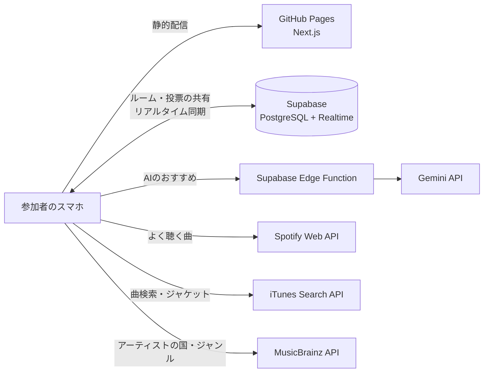

# [ミューコネ（MusiConnect）](https://jphacks.github.io/tkb_2619/)

共通の一曲が、心をつなぐ。その場のみんなが知っている曲・聴きたい曲を、スワイプ投票で見つける選曲アプリ。

## 各種リンク

- **アプリURL**: https://jphacks.github.io/tkb_2619/
<!-- デモ動画・発表スライドのURLができたらここに追加する -->

### アプリ QR コード

> [!TIP]
> スマートフォンでのアクセスがおすすめです。招待URLを開くだけで、アカウントなしでも参加できます。

## 製品概要

### 背景(製品開発のきっかけ、課題等）

上司とのカラオケで、何を歌えばいいか分からない。留学先のパーティーで、みんなが盛り上がる曲が分からない。サークルの初ドライブで、無難な曲ばかり流してしまう。

| シーン | ギャップ | 起きていること |
| --- | --- | --- |
| 上司とのカラオケ | 世代 | 上司の好きな曲が分からず、歌う曲を選びにくい |
| 留学先でのホームパーティー | 国籍 | 場が盛り上がる曲を流したいが、文化や言語の違いから選曲が難しい |
| サークルでの初ドライブ | 音楽ジャンル | 同乗者の好みが分からず、無難な曲ばかり流してしまう |

好きな曲が同じだと分かった瞬間、初対面でも一気に打ち解けられます。それなのに、相手の好みが分からないせいで、無難な曲しか流せないまま終わってしまう。

音楽ストリーミングのおすすめ機能は、「自分ひとりの好み」を当てることは得意です。ところが、カラオケや飲み会で本当に困っているのは「その場にいる全員が楽しめる曲が分からない」こと。共有プレイリストやグループ再生の機能もありますが、全員が同じサービスのアカウントを持っている必要があり、再生履歴のない人の好みは反映されません。「いま、この場で流す1曲」を決める仕組みは、まだありませんでした。

### 製品説明（具体的な製品の説明）

「好きな曲は？」と聞き合っても、気をつかって本音は出にくいものです。そこでミューコネは、好みを聞き出すのではなく、再生履歴の「被り」とスワイプの「反応」から見える化します。

1. **ルームを作る**: 幹事が、集まる人たちの年代・国籍・好きなジャンルなどを選んで、招待URLを発行
2. **URLから参加**: Spotify と連携するか、アカウントなしで参加
3. **曲の候補が集まる**: みんなが最近よく聴いている曲の「被り」、自分で検索して追加した曲、AIのおすすめ
4. **スワイプで投票**: 多くの人と被った曲から順に、上下左右のスワイプで評価
5. **ランキングで決める**: 投票のたびに順位が入れ替わり、最後は幹事が1曲を選んで Spotify で再生

ここまでの流れは、[公開サイト](https://jphacks.github.io/tkb_2619/)で実際に動かせます。

### 特長

#### 1. スワイプで、選曲がゲームになる

マッチングアプリのように、カードを上下左右にスワイプするだけ。上=Best(3点) / 右=Better(2点) / 下=So-so(1点) / 左=Nope(0点) で、指一本で直感的に評価できます。スワイプするたびに「Best!」と大きなリアクションが弾み、気づけば何十曲でも評価してしまいます。

カードには「◯◯が聴いてるよ！」と、その曲を誰が持ち込んだかが表示されます。「部長もこの曲聴くんですか！？」——知らなかった共通点が、そのまま会話のきっかけになります。

#### 2. 「みんなが聴いている曲」が見つかる

参加者それぞれが Spotify で過去1ヶ月によく聴いた曲を取り込み、参加者の間で重複している曲を見つけます。被った人数とよく聴いた度合いが大きい曲ほど上位に並ぶので、「全員が知っている曲」から投票できます。

#### 3. 集まった人みんなに届く曲を、AIが提案

年代に「20代」と「50代」を選ぶと、片方だけが知っている曲よりも、両方の世代に届く曲を優先して提案します（Gemini を利用）。再生履歴がない人がいても、年代や国籍から好みを補えます。AIの提案は iTunes とカタログで照合し、実在する曲だけをジャケット付きで候補に入れます。

#### 4. URLひとつで、その場の全員が参加できる

アプリのインストールもアカウントも不要です。幹事が招待URLを共有するだけで、全員のスマホがつながり、投票結果がリアルタイムで全員の画面に反映されます。

### 解決出来ること

- 選曲にかかる時間を短縮し、知らない曲ばかりが流れる状況を防ぐ
- 世代・国籍・ジャンルが違う相手とも、お互い知らなかった共通の好きな曲が見つかり、仲を深められる
- 声の大きい人の好みに偏らず、全員の投票で「いま流す1曲」を決められる

カラオケ・パーティー・ドライブだけでなく、結婚式の二次会、社内の懇親会、留学生の交流会など、人が集まって音楽を流す場面ならどこでも使えます。

### 今後の展望

- **曲の同一判定の精度向上**: 現在は「曲名＋アーティスト名」の一致で判定しています。ISRC（国際標準レコーディングコード）などの共通IDや MusicBrainz の別名データを使い、「Idol / アイドル」のような表記揺れも同じ曲として扱えるようにします
- **投票データから学ぶレコメンド**: スワイプの評価を蓄積し、似た顔ぶれの集団で好まれた曲を推薦します（協調フィルタリング）
- **法人化と有料プランで、Spotify・Apple Music を誰でも使えるように**: 現在の Spotify 連携は開発モードのため、事前に登録したメールアドレスのアカウントしか連携できません。誰でも連携できるようにする Spotify の審査（Extended Quota）は、法人であることや、商用サービスとして一定数の利用者がいることが条件になっています。そこで法人化して申請し、Apple Music（MusicKit を使うには Apple Developer Program への有料登録が必要）にも対応します。幹事向けの有料プランや、カラオケ店・イベント会場向けのプランで運営費と API の利用料をまかない、人数や回数を気にせず使えるサービスにします
- **他の音楽サービスへの対応**: 曲データの取得部分を分離しているので、YouTube Music などにも広げられます
- **再生までつなげる**: 決まった曲を Spotify のプレイリストに自動で追加したり、カラオケ機器の予約と連携したりします
- **セキュリティの強化**: 現在はハッカソン向けに、公開鍵で全ルームを読み書きできる設定です。ルームごとの参加トークンでアクセスを制限し、AIの呼び出しには回数制限を設けます

### 注力したこと（こだわり等）

- **スワイプの手触り**: カードが指に吸い付く動きと、評価した直後の大きなリアクションで、選曲そのものを楽しい時間にしました
- **「全員に届くか」で選ぶレコメンド**: 選んだ属性のうち何割の人に届くかで曲を評価し、一部の人だけが盛り上がる選曲を避けました
- **人数が増えても重くならない仕組み**: サーバーを持たない構成にし、AIはルームごとに1回だけ呼んで結果を全員で共有します。参加者が増えても、運用の手間とAIのコストが増えません
- **待たせない設計**: AIの応答待ちや混雑時のやり直しがあっても画面が止まらず、AIが使えないときは自動で別のおすすめ方法に切り替わります

## 開発技術

### 活用した技術

#### フロントエンド

- Next.js（App Router、静的書き出し）+ TypeScript
- Tailwind CSS
- Framer Motion（スワイプ操作・リアクション）

#### バックエンド・データ

- Supabase（PostgreSQL + Realtime）: ルーム・候補・投票の共有とリアルタイム更新
- Supabase Edge Functions（Deno）: AIのAPIキーをブラウザに出さずに Gemini を呼び出す
- Spotify Web API: 過去1ヶ月によく聴いた曲の取得（PKCE認証。再生回数は取得できないため、順位から重みを計算）
- iTunes Search API: 人気順の曲検索・ジャケット画像
- MusicBrainz API / Cover Art Archive: アーティストの国・ジャンル、ジャケット画像

#### AI

- Gemini API（gemini-3.5-flash-lite）: 集まった人の属性とみんなの好みから、実在の曲と理由を JSON で返す

#### インフラ

- GitHub Pages / GitHub Actions（main への push で自動デプロイ）

#### デバイス

- スマートフォン

### 独自技術

#### ハッカソンで開発した独自機能・技術

- **被り × よく聴く度合いの候補ランキング**: 何人が持ち込んだか、どれだけよく聴いているか、AIの提案かを合わせて候補を並べ、スワイプ平均と組み合わせて最終順位を決める（[`src/lib/logic/ranking.ts`](src/lib/logic/ranking.ts)）
- **集団カバー率に基づくレコメンド**: 選んだ属性のうち何割に届くかで曲を評価する（[`src/lib/logic/recommend.ts`](src/lib/logic/recommend.ts)）
- **AIの提案を実在の曲に照合**: Gemini が挙げた曲をカタログと iTunes で照合し、誤字を補正してジャケット付きで候補に入れる（[`src/lib/ai.ts`](src/lib/ai.ts)、[`supabase/functions/recommend-songs/`](supabase/functions/recommend-songs/index.ts)）
- **表記揺れを吸収した曲の同一判定**: 「Kenshi Yonezu / 米津玄師」のようなアーティスト名の違いを同じ曲として扱う（[`src/lib/music-source/normalize.ts`](src/lib/music-source/normalize.ts)）
- **ルームの保存先の抽象化とリアルタイム同期**: Supabase と同じブラウザ内のデモモードを同じインターフェースで切り替える（[`src/lib/room/`](src/lib/room/)）
- **スワイプ投票カード**: 4方向のスワイプ判定とリアクション表示（[`src/components/VoteCard.tsx`](src/components/VoteCard.tsx)、[`src/components/SwipeReaction.tsx`](src/components/SwipeReaction.tsx)）
