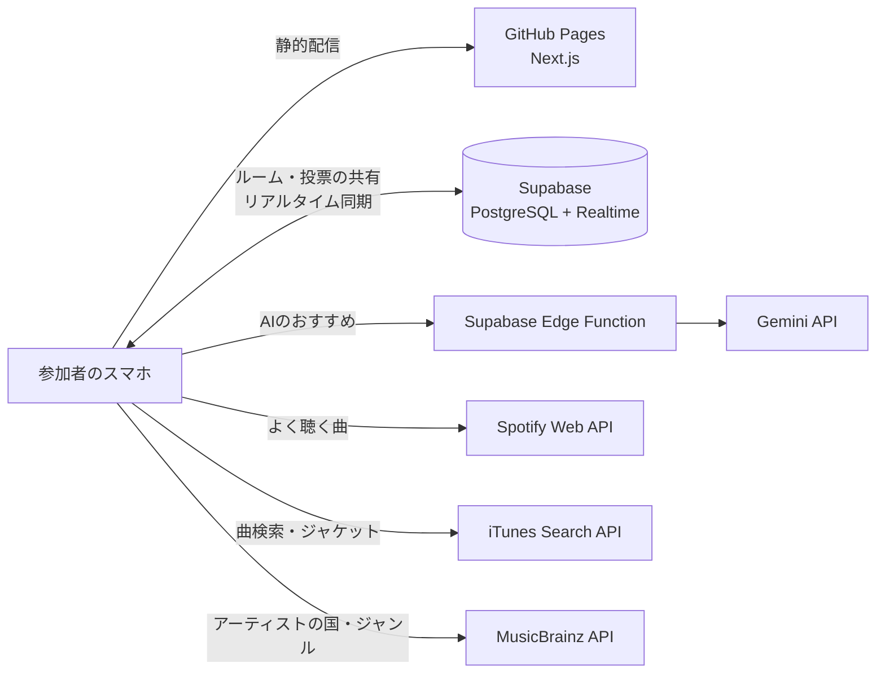

# [ミューコネ（MusiConnect）](https://jphacks.github.io/tkb_2619/)

**共通の一曲が、心をつなぐ。** その場のみんなが知っている曲・聴きたい曲を、スワイプ投票で見つける選曲アプリ。

## 各種リンク

- **アプリURL**: https://jphacks.github.io/tkb_2619/
<!-- デモ動画・発表スライドのURLができたらここに追加する -->

### アプリ QR コード

> [!TIP]
> スマートフォンでのアクセスがおすすめです。招待URLを開くだけで、アカウントなしでも参加できます。

## ひと目でわかるミューコネ

| 観点 | ミューコネの答え | 詳しく |
| --- | --- | --- |
| **着眼点** | 音楽サービスは「1人の好み」を当てる方向に進化してきた。でも、カラオケや飲み会で本当に困るのは「**その場にいる全員**が楽しめる曲が分からない」こと | [背景](#背景製品開発のきっかけ課題等) |
| **着想点** | 好みを口で聞き出すのではなく、**再生履歴の「被り」**と**スワイプの「反応」**で、みんなの好みを数秒で見える化する | [製品説明](#製品説明具体的な製品の説明) |
| **ユーザーニーズ** | 幹事・上司と部下・留学生・初対面のサークル。**招待URLだけで、アカウントなしでも参加**できる | [解決出来ること](#解決出来ること) |
| **スケーラビリティ** | サーバーを持たない構成で利用者が増えても運用が変わらない。AIは**ルームごとに1回**だけ呼ぶので、人数が増えてもコストが増えない | [スケーラビリティ](#スケーラビリティ) |
| **完成性** | ルーム作成 → 参加 → 候補集め（Spotify・検索・AI）→ スワイプ投票 → リアルタイムランキング → 最終選曲まで、**公開サイトで動作** | [完成度](#完成度hack-day-で動いているもの) |
| **わくわく要素** | **スワイプ投票**。マッチングアプリのような手軽さで評価でき、「◯◯が聴いてるよ！」という意外な発見が会話を生む | [わくわく要素](#わくわく要素スワイプ投票) |

## 製品概要

### 背景(製品開発のきっかけ、課題等）

> **着眼点**: 解いている問題が明確で新しいこと

世代・国籍・音楽の好みが違う人とカラオケ・パーティー・ドライブに行くと、相手がどんな音楽を好きなのか分からず、選曲に困ることがよくあります。

| シーン | ギャップ | 起きていること |
| --- | --- | --- |
| 上司とのカラオケ | 世代 | 上司の好きな曲が分からず、歌う曲を選びにくい |
| 留学先でのホームパーティー | 国籍 | 場が盛り上がる曲を流したいが、文化や言語の違いから選曲が難しい |
| サークルでの初ドライブ | 音楽ジャンル | 同乗者の好みが分からず、無難な曲ばかり流してしまう |

好みが合えば距離が縮まるはずなのに、相手の好みが分からないために無難な曲しか流せない。

音楽ストリーミングのおすすめ機能は「1人の好み」を当てるのが得意ですが、**その場にいる複数人の共通点を見つける**仕組みはほとんどありません。私たちはこの「**集団の選曲**」を、まだ解かれていない問題として捉えました。

### 製品説明（具体的な製品の説明）

> **着想点**: 既知の未解決の問題に対して、解き方が新しいこと

「好きな曲は？」と聞き合うと、気をつかって本音が出にくく、時間もかかります。ミューコネは、**データの「被り」**と**スワイプの「反応」**で、みんなの好みを数秒で見える化します。

1. **ルームを作成**: 幹事が、集まる人たちの属性（性別・ジャンル・国籍・年代は複数選択、その他は自由入力）を設定し、招待URLを発行
2. **招待URLから参加**: Spotifyと連携するか、アカウントなしで参加
3. **曲の候補を集める**（3つの方法）
   - **被る曲**: 各自が Spotify で過去1ヶ月によく聴いた曲から、参加者の間で重複している曲を抽出
   - **投稿**: 検索やおすすめから「Spotifyには入っていないけど知っている曲」を追加
   - **AIレコメンド**: 集団の属性とみんなの好みから、Gemini が「全員に届く曲」を提案
4. **スワイプで投票**: 被った人数が多い曲から順に表示され、上下左右のスワイプで評価
5. **みんなのランキング**: 投票が入るたびにリアルタイムで更新。最後は幹事が1曲を選び、Spotifyで再生

### 特長

#### 1. 「被る曲」の抽出

各参加者が Spotify で過去1ヶ月によく聴いた曲を取り込み、参加者の間で重複している曲を見つけます。被った人数とよく聴いた度合いをもとに順位を付け、上位の曲から投票に回します。

#### 2. スワイプ投票とリアルタイムランキング

上=Best(3点) / 右=Better(2点) / 下=So-so(1点) / 左=Nope(0点) の4方向スワイプで評価します。結果は全員の画面にリアルタイムで反映され、投票が入るたびに順位が入れ替わります。

#### 3. 集団の属性に合わせたAIレコメンド

年代に「20代」と「50代」を選ぶと、片方だけが知っている曲より**両方の世代に届く曲**を優先します。AI（Gemini）の提案は iTunes とカタログで照合し、実在する曲だけをジャケット付きで候補に入れます。

### わくわく要素（スワイプ投票）

> **わくわく要素**: 完成度の最高評価「プロダクトにわくわくする」

選曲の相談を、**ゲームのような体験**に変えました。

- **指一本で直感的に評価**: マッチングアプリのように上下左右へスワイプするだけ。会話を止めずに、みんなで同時に投票できる
- **評価するたびに反応が返る**: スワイプすると「Best!」「Better!」が大きく弾んで表示される
- **意外な「被り」の発見**: カードに「◯◯が聴いてるよ！」と、その曲を誰が持ち込んだかが出る。「部長もこの曲聴くんですか！？」が会話のきっかけになる
- **ランキングが動く**: 投票のたびに順位が入れ替わり、↑2 のように変動が見える

### 解決出来ること

> **ユーザーニーズ**: 実際に世の中で利用される可能性が高いこと

- 選曲にかかる時間を短縮し、知らない曲ばかりが流れる状況を防ぐ
- 世代・国籍・ジャンルが違う相手とも、お互い知らなかった共通の好きな曲が見つかり、仲を深められる

**想定ユーザー**: 飲み会・カラオケの幹事、上司と部下、留学生や旅行者と交流する人、初対面のサークル・ゼミ

**既存の手段との違い**

| | 口頭で聞く | 共有プレイリスト・グループ再生（例: Spotify のブレンド・Jam） | **ミューコネ** |
| --- | --- | --- | --- |
| 参加のしやすさ | ◯ | 全員が同じサービスのアカウントを持つ必要がある | **招待URLだけ。アカウントなしでも参加可** |
| 好みが分からない相手 | 聞き出しにくい | 再生履歴がない人の好みは反映されない | **世代・国籍などの属性からAIが補う** |
| 「いま流す1曲」を決める | 声の大きい人に偏る | 曲を混ぜて流すことが中心 | **全員の投票で順位を決め、幹事が最終決定** |

### スケーラビリティ

> **スケーラビリティ**: サービスのスケーラビリティが高いこと

- **サーバーを持たない構成**: 画面は GitHub Pages で静的配信し、データとリアルタイム同期は Supabase、AI は Supabase Edge Function が担当。利用者が増えても、自前のサーバーを増強・運用する必要がない
- **AIのコストが人数に比例しない**: AIは幹事の端末からルームごとに1回だけ呼び、結果をルームに保存して全員で共有する
- **導入の壁が低い**: アプリのインストールもアカウントも不要。URLを共有するだけで、その場の全員が使い始められる
- **音楽サービスを差し替えやすい設計**: 曲データの取得部分（`src/lib/music-source/`）を分離しており、Apple Music などにも広げられる
- **シーンを選ばない**: カラオケ・飲み会・ドライブに加え、結婚式の二次会、社内イベント、留学生交流会など「人が集まる場の選曲」全般に使える

### 完成度（Hack Day で動いているもの）

> **完成性**: 実装されたプロダクトによって、コンセプトで提示された課題が解決していること

[公開サイト](https://jphacks.github.io/tkb_2619/)で、次の一連の流れが動作します。

| 機能 | 状態 |
| --- | --- |
| ルーム作成・招待URLの発行・参加（Spotify連携 / アカウントなし） | ✅ 動作 |
| Spotify の過去1ヶ月のトップトラック取り込みと「被り」の抽出 | ✅ 動作（※） |
| 曲検索（iTunes）・あなたへのおすすめ | ✅ 動作 |
| AIレコメンド（Gemini、約8秒で8曲を提案） | ✅ 動作 |
| スワイプ投票・取り消し・スキップ | ✅ 動作 |
| リアルタイムランキングと最終選曲 | ✅ 動作 |

※ Spotify の開発モードの制限により、現在はチームが登録したアカウントのみ連携できます（[今後の展望](#今後の展望技術面)を参照）。

### 注力したこと（こだわり等）

- **スワイプの手触り**: カードが指に吸い付く動きと、評価直後の大きなリアクションで、何十曲でも続けたくなる体験にした
- **「集団全体に届くか」で選ぶレコメンド**: 選んだ属性のうち何割の人に届くかで曲を評価し、一部の人だけが盛り上がる選曲を避けた
- **待たせない設計**: AIの応答待ちや混雑時のやり直しを含めても、画面が止まらないようにした（AIが使えない場合は自動でルールベースのおすすめに切り替わる）

### 今後の展望（技術面）

- **曲の同一判定の精度向上**: 現在は「曲名＋アーティスト名」の一致で判定している。ISRC（国際標準レコーディングコード）などの共通IDや MusicBrainz の別名データを使い、「Idol / アイドル」のような表記揺れも同じ曲として扱う
- **投票データから学ぶレコメンド**: スワイプの評価を蓄積し、似た属性の集団で好まれた曲を推薦する（協調フィルタリング）
- **Spotify 連携の一般公開**: 現在は開発モードのため登録ユーザーのみ。Spotify の審査（Extended Quota）を経て、誰でも連携できるようにする
- **他の音楽サービスへの対応**: 曲データの取得部分を差し替える形で、Apple Music（MusicKit）や YouTube Music に対応する
- **再生までつなげる**: 決まった曲を Spotify のプレイリストに自動で追加する、カラオケ機器の予約と連携する
- **セキュリティの強化**: 現在はハッカソン向けに、公開鍵で全ルームを読み書きできる設定。ルームごとの参加トークンでアクセスを制限し、AI呼び出しにはレート制限を入れる

## 開発技術

### 活用した技術

#### フロントエンド

- Next.js（App Router、静的書き出し）+ TypeScript
- Tailwind CSS
- Framer Motion（スワイプ操作・リアクション）

#### バックエンド・データ

- Supabase（PostgreSQL + Realtime）: ルーム・候補・投票の共有とリアルタイム更新
- Supabase Edge Functions（Deno）: AIのAPIキーをブラウザに出さずに Gemini を呼び出す
- Spotify Web API: 過去1ヶ月によく聴いた曲の取得（PKCE認証。再生回数は取得できないため、順位から重みを計算）
- iTunes Search API: 人気順の曲検索・ジャケット画像
- MusicBrainz API / Cover Art Archive: アーティストの国・ジャンル、ジャケット画像

#### AI

- Gemini API（gemini-3.5-flash-lite）: 集団の属性とみんなの好みから、実在の曲と理由を JSON で返す

#### インフラ

- GitHub Pages / GitHub Actions（main への push で自動デプロイ）

#### デバイス

- スマートフォン

### 独自技術

#### ハッカソンで開発した独自機能・技術

- **被り × よく聴く度合いの候補ランキング**: 何人が持ち込んだか、どれだけよく聴いているか、AIの提案かを合わせて候補を並べ、スワイプ平均と組み合わせて最終順位を決める（[`src/lib/logic/ranking.ts`](src/lib/logic/ranking.ts)）
- **集団カバー率に基づくレコメンド**: 選んだ属性のうち何割に届くかで曲を評価する（[`src/lib/logic/recommend.ts`](src/lib/logic/recommend.ts)）
- **AIの提案を実在の曲に照合**: Gemini が挙げた曲をカタログと iTunes で照合し、誤字を補正してジャケット付きで候補に入れる（[`src/lib/ai.ts`](src/lib/ai.ts)、[`supabase/functions/recommend-songs/`](supabase/functions/recommend-songs/index.ts)）
- **表記揺れを吸収した曲の同一判定**: 「Kenshi Yonezu / 米津玄師」のようなアーティスト名の違いを同じ曲として扱う（[`src/lib/music-source/normalize.ts`](src/lib/music-source/normalize.ts)）
- **ルームの保存先の抽象化とリアルタイム同期**: Supabase と同じブラウザ内のデモモードを同じインターフェースで切り替える（[`src/lib/room/`](src/lib/room/)）
- **スワイプ投票カード**: 4方向のスワイプ判定とリアクション表示（[`src/components/VoteCard.tsx`](src/components/VoteCard.tsx)、[`src/components/SwipeReaction.tsx`](src/components/SwipeReaction.tsx)）
