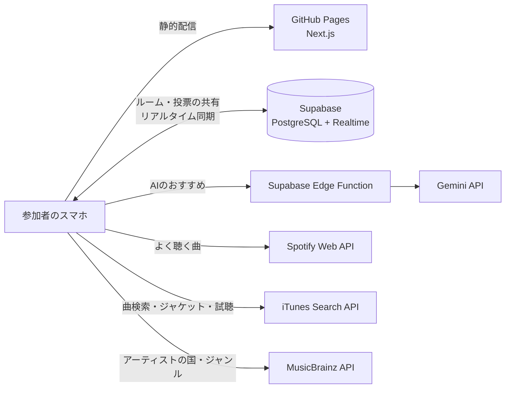

# [ミューコネ（MusiConnect）](https://jphacks.github.io/tkb_2619/)

共通の好みの曲が、心をつなぐ。世代も国籍も好きなジャンルも違うみんなで、スワイプ投票しながら「いま流す1曲」を見つける選曲アプリです。

## 各種リンク

- **アプリURL**: https://jphacks.github.io/tkb_2619/
<!-- デモ動画・発表スライドのURLができたらここに追加する -->

### アプリ QR コード

> [!TIP]
> スマートフォンでのアクセスがおすすめです。招待URLを開くだけで、アカウントなしでも参加できます。1人で試すときは、ルーム画面の「デモ用に5人追加する」を押すと、世代や国籍の違う5人が参加した状態を再現できます。

## 製品概要

### 背景(製品開発のきっかけ、課題等）

上司とのカラオケで、何を歌えばいいか分からない。留学先のパーティーで、みんなが盛り上がる曲が分からない。サークルの初ドライブで、無難な曲ばかり流してしまう。こんな経験、ありませんか？

| シーン | ギャップ | 起きていること |
| --- | --- | --- |
| 上司とのカラオケ | 世代 | 上司の好きな曲が分からず、歌う曲を選びにくい |
| 留学先でのホームパーティー | 国籍 | 場が盛り上がる曲を流したいが、文化や言語の違いから選曲が難しい |
| サークルでの初ドライブ | 音楽ジャンル | 同乗者の好みが分からず、無難な曲ばかり流してしまう |

好きな曲が同じだと分かった瞬間、初対面でも一気に打ち解けられます。それなのに、相手の好みが分からないせいで、無難な曲しか流せないまま終わってしまう。世代・国籍・音楽の好みの違いが、そのまま人と人との距離になってしまっているのです。

音楽ストリーミングのおすすめ機能は、「自分ひとりの好み」を当てることは得意です。ところが、人が集まる場で本当に困っているのは「その場にいる全員が楽しめる曲が分からない」こと。「いま、この場で流す1曲」をみんなで決める仕組みは、まだありませんでした。

### 製品説明（具体的な製品の説明）

「好きな曲は？」と聞き合っても、気をつかって本音は出にくいものです。そこでミューコネは、好みを聞き出すのではなく、再生履歴の「被り」とスワイプの「反応」から、みんなの共通点を見つけ出します。

1. **ルームを作る**: 幹事が、集まる人たちの年代・国籍・好きなジャンルなどを選んで、招待URLとQRコードを発行
2. **URLから参加**: 名前を入れて、Spotify と連携するか、アカウントなしで参加
3. **曲の候補が集まる**: みんなが最近よく聴いている曲の「被り」、自分で検索して追加した曲、AIのおすすめ
4. **スワイプで投票**: 多くの人と被った曲から順に、30秒の試聴をしながら上下左右のスワイプで評価
5. **ランキングで決める**: 投票のたびに順位が入れ替わり、1位から順に試聴しながら、幹事が次に流す曲を決める

ミューコネの機能は、どれも「共通の好みの曲で、心をつなぐ」というひとつのテーマから生まれています。

| 機能 | 心をつなぐための役割 |
| --- | --- |
| 再生履歴の「被り」を見つける | お互い知らなかった共通点に気づける |
| 集まった人の属性に合わせたAIの提案 | 誰か1人ではなく、全員に届く曲を候補にできる |
| スワイプ投票とリアルタイムランキング | 声の大きい人に偏らず、全員の反応で1曲を決められる |
| 「◯◯が聴いてるよ！」の表示 | 見つかった共通点が、そのまま会話のきっかけになる |

### 想定ユーザーとニーズ

使うのは、人が集まる場で選曲を任されがちな幹事と、その場に集まった参加者です。

| 想定ユーザー | ニーズ | ミューコネでできること |
| --- | --- | --- |
| 飲み会・カラオケの幹事 | 全員が楽しめる曲を、手間をかけずに決めたい | 集まる人の属性を選んで招待URLを送るだけで、候補が集まる |
| 世代の違う相手と過ごす人（上司と部下など） | 相手の好きな曲を知って、距離を縮めたい | 相手も聴いている曲が「◯◯が聴いてるよ！」で分かる |
| 留学生や国際交流の場の参加者 | 言葉や文化が違っても、一緒に盛り上がれる曲がほしい | 国籍を複数選ぶと、どの国の人にも届く曲をAIが提案する |
| 初対面のグループ（サークル・ドライブなど） | 好みを聞きにくく、本音を言いにくい | スワイプするだけで、気をつかわずに好みを伝えられる |

### 既存サービスとの違い

似たサービスを調べたところ、どれも「パーティーでのリクエスト」「1人の好み」「1対1の相性」が中心でした。

| サービス | できること | ミューコネとの違い |
| --- | --- | --- |
| Jukestar | パーティーでゲストが Spotify から曲をリクエストし、投票・拒否できる | AIの提案や、世代・好みの違いを埋める機能、スワイプ投票がない |
| Spotify のグループセッション | Premium ユーザーが同じ音楽を同時に聴き、プレイリストを一緒に操作できる | 全員が Spotify のアカウントを持つ必要がある。選曲の悩みを解決する機能はない |
| MusicMate | 音楽の好みで人と出会い、AIが会話のきっかけを提案する音楽SNS | 1対1の出会いが中心で、グループでの選曲やスワイプ投票はない |
| PULL | 友達と音楽の相性を診断し、おすすめのプレイリストを作る | 個人間の相性診断が中心で、その場でのリアルタイムな選曲はない |

ミューコネは、世代や国籍の違う集団が「いま流す1曲」を決める場面に絞り、再生履歴の被り、集団の属性に合わせたAIの提案、スワイプ投票の3つを組み合わせています。私たちが調べた範囲では、この組み合わせのサービスは見つかりませんでした。アカウントやアプリのインストールなしでも参加できるので、Spotify を使っていない人も置いていきません。

### スケーラビリティと今後の展望

人数・場面・音楽サービスが増えても、そのまま広げられる作りにしています。

- **人数が増えても重くならない**: サーバーを持たない構成で、ルームや投票の共有は Supabase のリアルタイム同期に任せています。AIはルームごとに1回だけ呼び、結果を全員で共有するので、参加者が増えてもAIのコストは増えません
- **場面を選ばない**: カラオケ・パーティー・ドライブだけでなく、結婚式の二次会、社内の懇親会、留学生の交流会など、人が集まって音楽を流す場面ならどこでも使えます
- **国境を越えて使える**: 国籍の選択肢と画面の多言語化を進めれば、訪日客との交流や海外のパーティーにもそのまま広げられます
- **音楽サービスを差し替えられる**: 曲データの取得部分を分離しているので、YouTube Music などにも対応できます

今後は、次のように広げていきます。

- **法人化と有料プランで、Spotify・Apple Music を誰でも使えるように**: 現在の Spotify 連携は開発モードのため、事前に登録したメールアドレスのアカウントしか連携できません。誰でも連携できるようにする Spotify の審査（Extended Quota）は、法人であることや、商用サービスとして一定数の利用者がいることが条件になっています。そこで法人化して申請し、Apple Music（MusicKit を使うには Apple Developer Program への有料登録が必要）にも対応します。幹事向けの有料プランや、カラオケ店・イベント会場向けのプランで運営費と API の利用料をまかない、人数や回数を気にせず使えるサービスにします
- **投票データから学ぶレコメンド**: スワイプの評価を蓄積してAIの提案にも反映し、似た顔ぶれの集団で好まれた曲を推薦します（協調フィルタリング）
- **曲にまつわる思い出を共有する**: 決まった曲に「なぜ好きか」「どんな思い出があるか」をひと言添えられるようにし、共通の一曲から会話をさらに広げます
- **曲の同一判定の精度向上**: ISRC（国際標準レコーディングコード）などの共通IDや MusicBrainz の別名データを使い、「Idol / アイドル」のような表記揺れも同じ曲として扱えるようにします
- **再生までつなげる**: 決まった曲を Spotify のプレイリストに自動で追加したり、カラオケ機器の予約と連携したりします
- **セキュリティの強化**: 現在も、ルームや参加者の削除・書き換えはデータベース側で禁止しています。今後はルームごとの参加トークンで、招待された人だけがルームを読めるようにし、AIの呼び出しには回数制限を設けます

### 解決出来ること

- 選曲にかかる時間を短縮し、知らない曲ばかりが流れる状況を防ぐ
- 世代・国籍・ジャンルが違う相手とも、お互い知らなかった共通の好きな曲が見つかり、仲を深められる
- 声の大きい人の好みに偏らず、全員の投票で「いま流す1曲」を決められる

ここまでの流れは、すべて[公開サイト](https://jphacks.github.io/tkb_2619/)で動きます。複数のスマホで同じルームに入ると、投票結果がリアルタイムで全員の画面に反映されます。AIの提案は、ルームを作ってから10秒ほどでジャケット付きの候補として届きます。どの曲もアプリの中で30秒試聴でき、結果画面ではランキングの1位から順に流せます。Spotify と連携できない人も、曲を検索して候補に入れれば同じように参加できます。

<!-- ユーザーテストを行ったら、人数・場面・結果（例: 選曲にかかった時間、参加者の感想）をここに追記する -->

### 特長：スワイプで、選曲がゲームになる

マッチングアプリのように、カードを上下左右にスワイプするだけ。上=Best(3点) / 右=Better(2点) / 下=So-so(1点) / 左=Nope(0点) で、指一本で直感的に評価できます。スワイプするたびに「Best!」と大きなリアクションが弾み、気づけば何十曲でも評価してしまいます。

カードには「◯◯が聴いてるよ！」と、その曲を誰が持ち込んだかが表示されます。「部長もこの曲聴くんですか！？」——知らなかった共通点が見つかるたびに、場が盛り上がります。投票のたびにランキングが入れ替わるので、どの曲が1位になるかを全員でワクワクしながら見守れます。

### 注力したこと（こだわり等）

- **スワイプの手触り**: カードが指に吸い付く動きと、評価した直後の大きなリアクションで、選曲そのものを楽しい時間にしました
- **「全員に届くか」で選ぶレコメンド**: 選んだ属性のうち何割の人に届くかで曲を評価し、一部の人だけが盛り上がる選曲を避けました
- **AIの提案を実在の曲だけに絞る**: AIが挙げた曲を iTunes とカタログで照合し、実在が確認できた曲だけをジャケット付きで候補に入れます
- **待たせない設計**: AIの応答待ちや混雑時のやり直しがあっても画面が止まらず、AIが使えないときは自動で別のおすすめ方法に切り替わります

## 開発技術

### 活用した技術

#### フロントエンド

- Next.js（App Router、静的書き出し）+ TypeScript
- Tailwind CSS
- Framer Motion（スワイプ操作・リアクション）

#### バックエンド・データ

- Supabase（PostgreSQL + Realtime）: ルーム・候補・投票の共有とリアルタイム更新
- Supabase Edge Functions（Deno）: AIのAPIキーをブラウザに出さずに Gemini を呼び出す
- Spotify Web API: 過去1ヶ月によく聴いた曲の取得（PKCE認証。再生回数は取得できないため、順位から重みを計算）
- iTunes Search API: 人気順の曲検索・ジャケット画像・30秒の試聴
- MusicBrainz API / Cover Art Archive: アーティストの国・ジャンル、ジャケット画像

#### AI

- Gemini API（gemini-3.5-flash-lite）: 集まった人の属性とみんなの好みから、実在の曲と理由を JSON で返す

#### インフラ

- GitHub Pages / GitHub Actions（main への push で自動デプロイ）

#### デバイス

- スマートフォン

### 独自技術

#### ハッカソンで開発した独自機能・技術

- **被り × よく聴く度合いの候補ランキング**: 何人が持ち込んだか、どれだけよく聴いているか、AIの提案かを合わせて候補を並べ、スワイプ平均と組み合わせて最終順位を決める（[`src/lib/logic/ranking.ts`](src/lib/logic/ranking.ts)）
- **集団カバー率に基づくレコメンド**: 選んだ属性のうち何割に届くかで曲を評価する（[`src/lib/logic/recommend.ts`](src/lib/logic/recommend.ts)）
- **AIの提案を実在の曲に照合**: Gemini が挙げた曲をカタログと iTunes で照合し、誤字を補正してジャケット付きで候補に入れる（[`src/lib/ai.ts`](src/lib/ai.ts)、[`supabase/functions/recommend-songs/`](supabase/functions/recommend-songs/index.ts)）
- **表記揺れを吸収した曲の同一判定**: 「Kenshi Yonezu / 米津玄師」のようなアーティスト名の違いを同じ曲として扱う（[`src/lib/music-source/normalize.ts`](src/lib/music-source/normalize.ts)）
- **ルームの保存先の抽象化とリアルタイム同期**: Supabase と同じブラウザ内のデモモードを同じインターフェースで切り替える（[`src/lib/room/`](src/lib/room/)）
- **スワイプ投票カード**: 4方向のスワイプ判定とリアクション表示（[`src/components/VoteCard.tsx`](src/components/VoteCard.tsx)、[`src/components/SwipeReaction.tsx`](src/components/SwipeReaction.tsx)）
