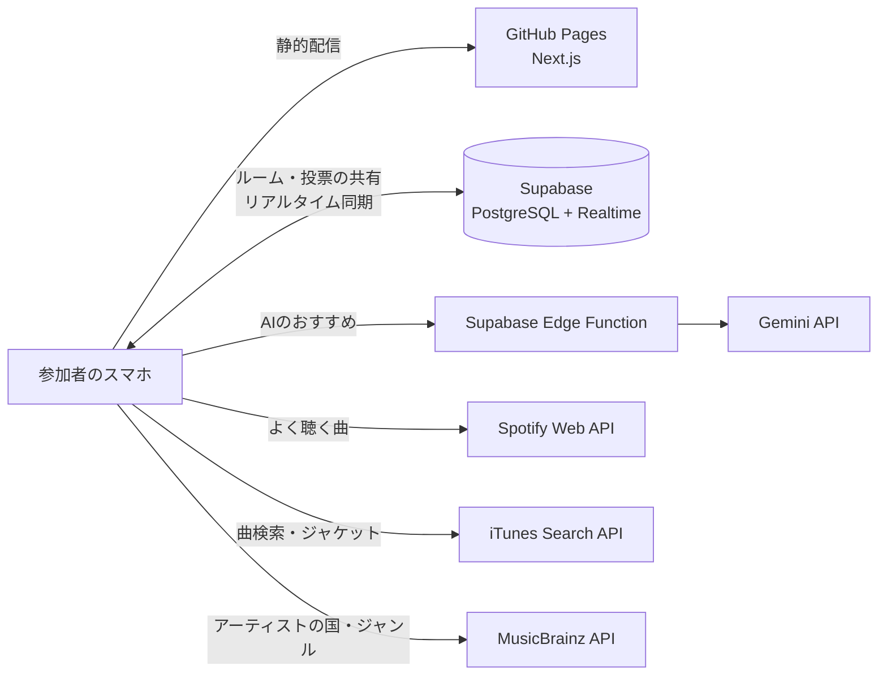

# [ミューコネ（Musiconnect）](https://jphacks.github.io/tkb_2619/)

共通の好みの音楽で心を繋ぐ。ミューコネなら世代も国籍も好みも違うみんなで、スワイプ投票しながら「今流す曲」を見つけられる。

## 各種リンク

- **アプリURL**: https://jphacks.github.io/tkb_2619/
- **参加者用URL**: https://jphacks.github.io/tkb_2619/join?room=mbbr4dbwzy

> [!NOTE]
> 現状は無料版の Spotify API を用いているので、事前登録されたアカウントでないと Spotify 連携ができません。我々のアカウントで登録した上記の参加者用ルームにゲストとして参加して、楽曲投稿や投票、ランキング表示などの機能を利用できます。
> また、作成者としてゲストでルームを作ることも可能です。その場合は、AIレコメンドの調節機能も利用できます。

### アプリ QR コード

## 製品概要

- **着眼点**
  - 世代・国籍・タイプが違う人と一緒に、音楽が関係する場に行くと、相手がどんな音楽を好きなのか分からず、選曲に困ることが多い
- **着想点**
  - その場にいる人が音楽アプリでよく聞く曲を抽出し、投票によってそれらをスワイプにより評価する。評価の高い曲をランキング形式で並べることで、共通の好みの曲が分かり、選曲に困らなくなる。
- **実行・実現可能性**
  - カラオケ・ドライブ・パーティーなど、他の人と音楽を共有する場すべてで使える。とくに一緒にいる人の世代・国籍・タイプが異なるなど、相手の好みを理解しづらい時に効果を発揮する。
  - 競合と比較すると、再生履歴などから、場にいる全員のデータをもとにしたリアルタイムの曲レコメンドを行える点が優れている。また、スワイプ投票機能を加えることで、楽しみながら、今欲しい楽曲を皆で選ぶことができる。
  - Spotify だけでなく、Apple Music などのアプリも連携できるようにすることで、スケーリングを目指す
- **完成度・動作性**
  - その場にいる全員がサービスを使わないといけないという課題に対して、URLとQRを導入して、周りの人に容易に共有できるようにした
  - その場にいる人の好きな曲がわからないという課題を、Spotify の履歴とAIレコメンド機能によって解決した
  - 投票が手間になるという課題に対して、スワイプという楽しいUXを導入したことで解決した

### 背景

世代・国籍・好きな音楽のタイプがちがう人と、カラオケやドライブ、パーティーに行くと、相手がどんな曲を好きなのかわからず、選曲に困ることが多いです。

例えば、上司とのカラオケで、何を歌えばいいか分からない。留学先の自宅パーティーで、盛り上がる曲が分からない。サークルの初ドライブで、無難な曲ばかり流してしまうなど。みなさん一度は経験したことがあるのではないでしょうか？

この問題の背景にあるのは「相手がどんな曲を好きなのかわからない」という課題です。

既存の音楽ストリーミングのおすすめ機能は「自分一人の好み」を当てることは得意ですが、私たちは「みんなが好きな曲」を探し当てることに焦点を当て、この課題の解決を目指しました。

### 機能説明

前述の課題を解決するために、共通の好みの音楽候補を洗い出し、それを投票して評価することで、今流すべき曲を簡単に決めることができるアプリを作成しました。

候補だしでは、参加者全員が Spotify などの連携を行い、再生履歴から、お互いに被る楽曲を抽出したり、AIレコメンドによって例えば50代に人気の楽曲を投票候補として洗い出します。投票では、楽曲候補に対して、マッチングアプリのように上下左右のスワイプで4段階評価を行います。そして最後に、スワイプの評価をもとに楽曲がランキング化されて、上位の曲を流すと、みんなが盛り上がれるものが流れるという仕組みです。

#### 利用詳細

1. **ルームを作る**
   - 幹事が、集まる人たちの年代・国籍・好きなジャンルなどを選んで、招待URLを発行
2. **URLから参加**
   - Spotify と連携するか、ゲストとして参加
3. **曲の候補が集まる**
   - 参加者のSpotifyの過去1ヶ月間の再生履歴をもとに、お互いの被る曲を候補とする
   - 世代や国籍、ジャンルなどの絞り込みを行い、AIが絞り込みに沿った人気曲を候補とする
   - 自分で候補曲として投稿する
4. **スワイプで投票**
   - 追加された候補曲を上下左右のスワイプで4段階評価
5. **ランキングで決める**
   - 投票のたびに順位が入れ替わり、上位にある曲を幹事が選んで流す

**みんなが聴きたい曲が流れて、世代や国籍、タイプに関わらず全員で盛り上がれる！**

| 1. ルームを作る | 2. URLから参加 | 3. 曲の候補が集まる | 4. スワイプで投票 | 5. ランキングで決める |
| :---: | :---: | :---: | :---: | :---: |
|  |  |  |  |  |

#### 実際の操作映像

| ルームを作り、Spotify と連携して参加 | スワイプで投票し、1位から試聴 |
| :---: | :---: |
|  |  |

### 特長

#### 1. 好きな音楽にLikeしよう

マッチングアプリのように、曲の画像を自分の好みに合わせて、上下左右にスワイプするだけです。採点方法は、上=Best(3点)、右=Better(2点)、下=So-so(1点)、左=Nope(0点)、にスワイプします。

指一本で直感的に負担少なく、かつ楽しく投票ができる設計にしています。

#### 2. 「みんなが聴いている曲」が見つかる

参加者それぞれの Spotify アカウントで過去1ヶ月によく聴いた曲を取り込みます。そして、参加者の間で再生履歴が重複している曲を見つけます。聞いたことのある人数とその曲をよく聴いた回数が大きい曲ほど優先的に、投票画面に表示されます。そして、「全員が知っている曲」から投票できます。

投票画面の右上には「◯◯が聴いてるよ！」と、その曲を誰が持ち込んだかが表示されます。「部長もこの曲聴くんですか！？」と知らなかった共通点が、そのまま会話のきっかけになります。

#### 3. 集まった人みんなに届く曲を、AIが提案

ルームを作る際には、性別や、ジャンル、国籍、年代、好みを入力します。参加者の聞いている曲の被りだけでは拾いきれない、世代ヒットソングや海外で流行っている日本の曲などをAIのおすすめとして提案します。

#### 4. URLまたはQRコードを共有するだけで、その場の全員が参加できる

幹事はアプリ内で作成された招待URLやQRコードを共有するだけで、全員のスマホがつながり、投票や結果がリアルタイムで全員の画面に反映されます。

### 解決出来ること

- 選曲にかかる時間を短縮します。
- 知らない曲ばかりでつまらないと感じる状況を防ぎます
- 世代・国籍・ジャンルが違う相手とも、お互い知らなかった共通の好きな曲が見つかり、仲を深められる
- 全員の投票によって、声の大きい人の好みに偏らず、みんなが好きな曲を流せるようになります

カラオケ・パーティー・ドライブだけでなく、結婚式の二次会、社内の懇親会、留学生の交流会など、人が集まって音楽を流す場面ならどこでも使えます。

### 競合優位性

- 競合として、Jukestar というアプリが挙げられます。
- 現状で競合となる音楽レコメンドアプリでは、よく聞く音楽からAIが相性を診断したり、誰かが選択した曲に対して可否を示したりする機能はあったが、音楽アプリの再生履歴からリアルタイムでメンバー全員のよく聞く曲を候補として出して選定する一連のプロセスを持っているアプリはありませんでした。

### 今後の展望

- データがたまれば、過去の投票を元に個別最適化を行い、投票がなくてもレコメンドを行えるようにします。
- グループの法人化と有料プランで、Spotify・Apple Music との連携を誰でも行えるようにします。
  - 現在の Spotify 連携は開発モードであるため、事前に登録したメールアドレスのアカウントしか連携できません。誰でも連携できるようにする Spotify の審査は、法人であることや、商用サービスとして一定数の利用者がいることが条件になっています。そこで法人化して申請し、Spotify にも対応します。また、Apple Developer Program への有料登録も行い、Apple Music にも対応します。

### 技術面のこだわり

- **スワイプの手触り**: カードが指に吸い付く動きと、評価した直後のBest!といった視覚的にわかりやすいスタンプで、選曲することを負担に感じない楽しい設計にしました
- **「全員に届くか」で選ぶレコメンド**: 選んだ属性のうち何割の人に届くかで曲を評価し、一部の人だけが盛り上がる選曲を避ける設計にしています
- **人数が増えても重くならない仕組み**: サーバーを持たない構成にし、AIはルームごとに1回だけ呼んで結果を全員で共有します。アプリ参加者が増えても運用の手間とAIのコストが増えないため、安定したユーザビリティを保てます。
- **ユーザーを待たせない設計**: AIの応答待ちや混雑時のやり直しがあっても画面が止まらず、AIが使えないときは自動で別のおすすめ方法に切り替わります（AIは画面とは別に非同期で呼び出し、Edge Function 側で40秒のタイムアウトと1回の自動リトライを設定。失敗時は集団カバー率に基づくレコメンドで代替）

## 開発技術

### 活用した技術

#### フロントエンド

- Next.js（App Router、静的書き出し）+ TypeScript
- Tailwind CSS
- Framer Motion（スワイプ操作・リアクション）

#### バックエンド・データ

- Supabase（PostgreSQL + Realtime）: ルーム・候補・投票の共有とリアルタイム更新
- Supabase Edge Functions（Deno）: AIのAPIキーをブラウザに出さずに Gemini を呼び出す
- Spotify Web API: 過去1ヶ月によく聴いた曲の取得（PKCE認証。再生回数は取得できないため、順位から重みを計算）
- iTunes Search API: 人気順の曲検索・ジャケット画像
- MusicBrainz API / Cover Art Archive: アーティストの国・ジャンル、ジャケット画像

#### AI

- Gemini API（gemini-3.5-flash-lite）: 集まった人の属性とみんなの好みから、実在の曲と理由を JSON で返す

#### インフラ

- GitHub Pages / GitHub Actions（main への push で自動デプロイ）

#### デバイス

- スマートフォン

### 独自技術

#### ハッカソンで開発した独自機能・技術

- **被り × よく聴く度合いの候補ランキング**: 何人が持ち込んだか、どれだけよく聴いているか、AIの提案かを合わせて候補を並べ、スワイプ平均と組み合わせて最終順位を決める（[`src/lib/logic/ranking.ts`](src/lib/logic/ranking.ts)）
- **集団カバー率に基づくレコメンド**: 選んだ属性のうち何割に届くかで曲を評価する（[`src/lib/logic/recommend.ts`](src/lib/logic/recommend.ts)）
- **AIの提案を実在の曲に照合**: Gemini が挙げた曲をカタログと iTunes で照合し、誤字を補正してジャケット付きで候補に入れる（[`src/lib/ai.ts`](src/lib/ai.ts)、[`supabase/functions/recommend-songs/`](supabase/functions/recommend-songs/index.ts)）
- **表記揺れを吸収した曲の同一判定**: 「Kenshi Yonezu / 米津玄師」のようなアーティスト名の違いを同じ曲として扱う（[`src/lib/music-source/normalize.ts`](src/lib/music-source/normalize.ts)）
- **ルームの保存先の抽象化とリアルタイム同期**: Supabase と同じブラウザ内のローカルモードを同じインターフェースで切り替える（[`src/lib/room/`](src/lib/room/)）
- **スワイプ投票カード**: 4方向のスワイプ判定とリアクション表示（[`src/components/VoteCard.tsx`](src/components/VoteCard.tsx)、[`src/components/SwipeReaction.tsx`](src/components/SwipeReaction.tsx)）
